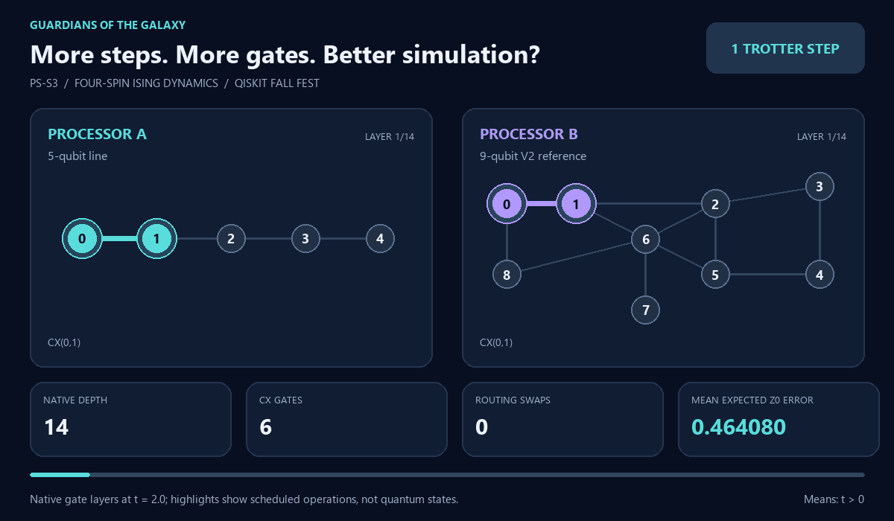

<div align="center">


<p><sub>QISKIT FALL FEST 2026 · SRM UNIVERSITY-AP · QUANTUM SIMULATION</sub></p>

# Trotter Error vs Synthetic Device Noise

### More steps. More gates. Better simulation?

**PS-S3 · Phase 1**

## Guardians Of The Galaxy

Four spins. Two processor architectures. One accuracy–noise tradeoff.

<p>
  <a href="main.ipynb"><b>Explore the notebook</b></a> &nbsp; · &nbsp;
  <a href="report.md"><b>Read the analysis</b></a> &nbsp; · &nbsp;
  <a href="results/tables/benchmark_results.csv"><b>Inspect the data</b></a>
</p>



<sub>Actual compiled gate layers at t = 2.0 · Reference Processor A vs Processor B<br>Highlights show scheduled gates, not quantum-state motion or hardware timing. Summary metrics average over positive times.</sub>

</div>

---

## The experiment in 30 seconds

A finer Trotter decomposition approximates quantum evolution more accurately. It also produces a longer circuit, exposing the state to more noisy gates. Which effect wins?

This project follows a four-spin transverse-field Ising chain through **exact evolution**, **ideal Trotter evolution**, and **noisy Qiskit Aer simulation**. The same workload runs on the V2 guide’s five-qubit and nine-qubit reference processors, with identical synthetic noise rates.

| Study | Scope |
| --- | --- |
| Model | Four-spin, open-boundary transverse-field Ising chain; J = g = 1 |
| Trotter decomposition | First order; **1, 2, and 4 steps** |
| Evolution times | 9 values from **0 to 2**, spaced by 0.25 |
| Processor placement | Optimized SABRE and fixed `[0, 1, 2, 3]` |
| Benchmark size | **108 configurations · 216 ideal/noisy sampled runs** |
| Sampling | **4,096 shots** per circuit |
| Exact reference | Independent dense Hamiltonian and SciPy matrix exponential |
| Validation | **28 regression tests passed**; fresh execution of all 6 notebook code cells |

**The result:** four steps produce the lowest mean expected Z₀ error among the tested choices. The improvement in the Trotter approximation outweighs the additional gate noise over this range.

[Results](#what-the-results-show) · [Processors](#two-architectures-one-controlled-comparison) · [Method](#from-hamiltonian-to-measurement) · [Quick start](#run-the-experiment) · [Files](#repository-map) · [Team](#the-team)

## What the results show

Both processors give the following expected results to numerical precision under optimized placement. Means exclude t = 0.

| Trotter steps | Depth | CX gates | Mean Trotter error in Z₀ | Mean total expected error in Z₀ | Mean noisy fidelity to exact state |
| ---: | ---: | ---: | ---: | ---: | ---: |
| 1 | 14 | 6 | 0.474071 | 0.464080 | 0.400257 |
| 2 | 25 | 12 | 0.105239 | 0.109397 | 0.536621 |
| **4** | **47** | **24** | **0.009643** | **0.022500** | **0.787998** |

From one to four steps, mean expected observable error decreases by **95.2%**, while noise-only fidelity falls from **0.966610 to 0.865980**. The circuit becomes more sensitive to noise, yet the final simulated state becomes more accurate because the approximation improves substantially.


### Why does the larger processor tie?

The logical interaction graph is a path. **Both physical processors already contain the path `0–1–2–3`**, so both can execute it without routing SWAPs. This holds for optimized and fixed placement across all tested cases. Extra connectivity offers no gate-count advantage for this workload under uniform noise.

Small differences in sampled outcomes reflect finite-shot simulation. There is no aggregate noise crossover among n = 1, 2, and 4, and these results do not establish a universal optimal step count.

**Follow the evidence:** [108-row benchmark](results/tables/benchmark_results.csv) · [12-row summary](results/tables/summary.csv) · [Detailed report](report.md)

## Two architectures, one controlled comparison

| Processor A · Baseline | Processor B · Contemporary reference |
| :---: | :---: |
|  |  |
| **5 qubits · 4 links** | **9 qubits · 12 links** |
| V2 guide’s linear-chain option | V2 guide’s heavy-hex-inspired reference |

The guide allows custom graphs; this study selects its listed reference architectures. Each physical link supports CX in both directions. “Heavy-hex-inspired” follows the guide’s label; it is not a calibrated IBM hardware model.

<details>
<summary><b>Exact coupling maps and source record</b></summary>

**A:** `(0,1), (1,2), (2,3), (3,4)`

**B:** `(0,1), (1,2), (1,6), (2,3), (2,6), (2,5), (3,4), (4,5), (5,6), (6,7), (6,8), (8,0)`

The [processor JSON files](processors/) define connectivity, directions, positions, noise, and compilation settings. The [reference record](data/raw/processor_reference.json) identifies page 2 of the V2 guide and records the source document’s SHA-256. The notebook checks the exact edge sets before running.

</details>

## From Hamiltonian to measurement

$$
H = -J\sum_{i=0}^{2} Z_i Z_{i+1} - g\sum_{i=0}^{3} X_i,
\qquad J=g=1,\quad \hbar=1.
$$

Starting from $|0000\rangle$, each first-order Trotter step applies the **ZZ interaction block followed by the X-field block**. The corresponding rotation angles are $-2Jt/n$ and $-2gt/n$. The main observable is $\langle Z_0\rangle$; full-state fidelities track accuracy beyond that single measurement.

```text
Build the Ising model → Construct Trotter circuits → Map to A and B
        ↓                         ↓                       ↓
Exact SciPy reference     n = 1, 2, 4              Audit native gates
        └─────────────────────────┴───────────────────────┘
                                  ↓
                    Paired ideal / noisy Aer runs
                                  ↓
                 Observable errors · Fidelities · Resources
```

| Controlled setting | Value |
| --- | --- |
| Native basis | `rz`, `sx`, `x`, `cx` |
| One-qubit depolarizing parameter | 0.001 after every `rz`, `sx`, and `x` |
| CX depolarizing parameter | 0.005 |
| Symmetric readout error | 0.01 |
| Optimization level / seeds | Level 1 / transpiler 42 / simulator 42 |
| SABRE | 20 layout/swap trials; 3 layout iterations |
| Simulator | Aer density matrix |

Each ideal/noisy pair uses the **same compiled circuit**. Logical measurements and reduced density matrices follow the final layout. Routing SWAPs are audited before native decomposition, and state fidelities are evaluated before readout noise. Sampled measurements include standard errors and Wilson 95% intervals.

<details>
<summary><b>Reading the error metrics</b></summary>

- **Trotter error:** ideal Trotter observable versus exact evolution.
- **Gate-noise shift:** gate-noisy observable versus ideal Trotter evolution.
- **Readout shift:** expected measured observable versus the pre-readout value.
- **Sampling shift:** finite-shot estimate versus its expected value.
- **Total expected error:** absolute difference between the expected noisy measurement and exact evolution.

Signed contributions can cancel; their absolute magnitudes do not add to the total error. Fidelity to the exact state and fidelity to the ideal Trotter state answer different questions. Definitions and derivations are in the [report](report.md).

</details>

<details>
<summary><b>More experiment figures</b></summary>


</details>

## Run the experiment

The recorded environment uses **Python 3.12.14 · Qiskit 2.5.2 · Qiskit Aer 0.17.2** on Windows. Dependencies are pinned in [requirements.txt](requirements.txt). The experiment needs no external dataset or quantum-service credentials.

```powershell
git clone https://github.com/udbhav-metla/Qskit_Online.git
cd Qskit_Online
python -m venv .venv
.\.venv\Scripts\Activate.ps1
python -m pip install -r requirements.txt
python -c "from src.metrics import run_benchmark; run_benchmark()"
```

On Linux or macOS, activate with `source .venv/bin/activate`.

For an interactive walkthrough, open [main.ipynb](main.ipynb) in VS Code or a Jupyter frontend, select the project environment, and **Run All**. Notebook frontend software is installed separately. Reruns replace generated experiment outputs.

## Repository map

```text
Qskit_Online/
├── README.md
├── main.ipynb
├── requirements.txt
├── data/
│   ├── raw/
│   └── processed/
├── processors/
│   ├── processor_A.json
│   └── processor_B.json
├── src/
│   ├── __init__.py
│   ├── problem.py
│   ├── processors.py
│   ├── routing.py
│   ├── metrics.py
│   └── visualization.py
├── results/
│   ├── tables/
│   └── figures/
├── report.md
└── assets/
    ├── branding/
    ├── media/
    └── qff_phase1_latex_images/
```

| Explore | What you will find |
| --- | --- |
| [Notebook](main.ipynb) | Complete experiment, checks, tables, and figures |
| [Source](src/) | Physics, processor loading, routing, simulation, and visualization |
| [Raw data](data/raw/) | Counts, configurations, routing audits, 108 QPY circuits, and validation records |
| [Processed data](data/processed/) | Exact states, Hamiltonian, and logical density matrices |
| [Results](results/) | Benchmark CSV/JSON tables and six scientific figures |
| [Report](report.md) | Derivation, architectural analysis, references, and limitations |
| [Media](assets/media/) | Opening animation, poster, source renderer, and schedule metadata |

## The team

### Guardians Of The Galaxy

**SRM University-AP · Quantum Simulation · PS-S3**

| Member | Role |
| --- | --- |
| Udbhav Sai Karthik Metla | Team leader |
| Shoaib Junaid Khan | Member |
| Yugal Patil | Member |
| Varla Mukesh | Member |
| Arko Dev Roy | Member |

## Scope

This is a controlled study of two reference graphs, one primary initial state, one compiler seed, and three Trotter step counts. The synthetic model includes depolarizing gate noise and readout errors; it omits thermal relaxation, idle errors, crosstalk, and connectivity-related calibration costs. Conclusions apply to these settings and do not establish hardware performance or quantum advantage.

---

<div align="center">

**Guardians Of The Galaxy** · Qiskit Fall Fest 2026

<sub>Four spins. Reproducible circuits. Evidence behind every result.</sub>

</div>
