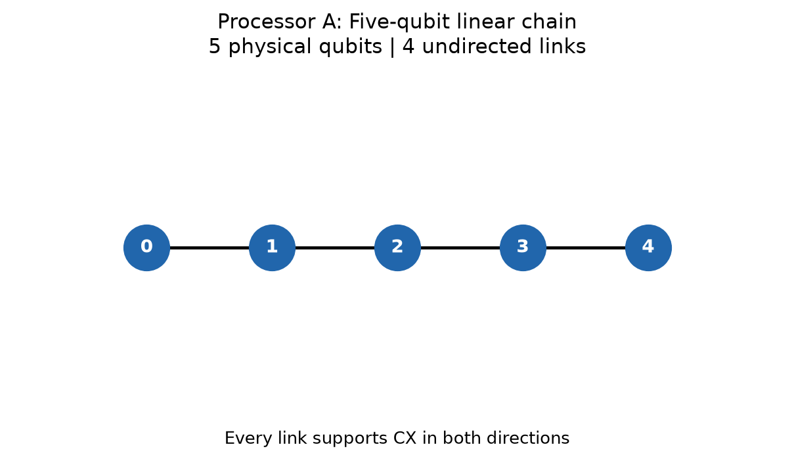
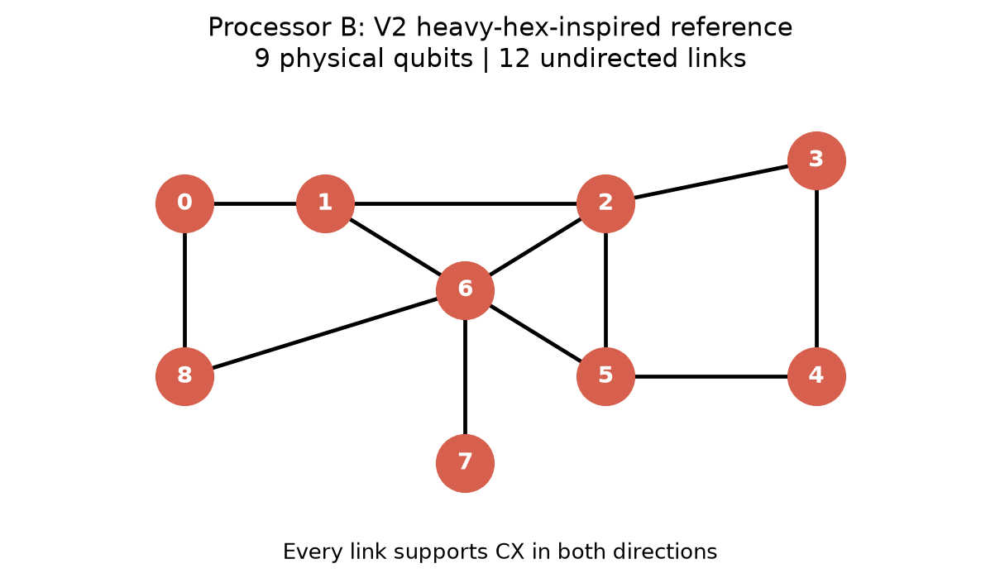
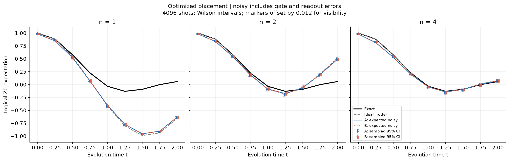
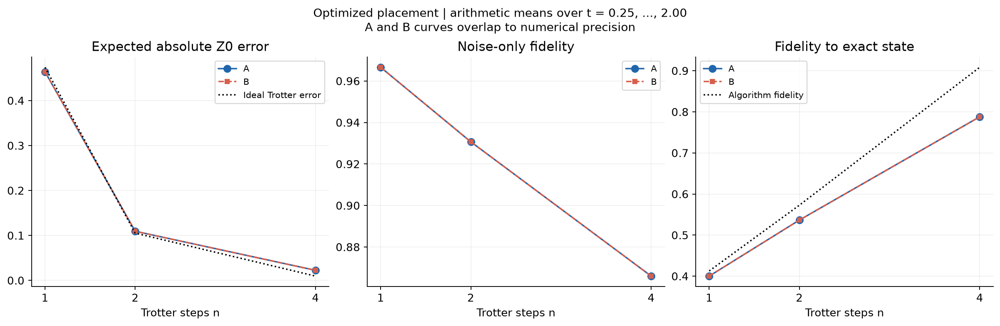
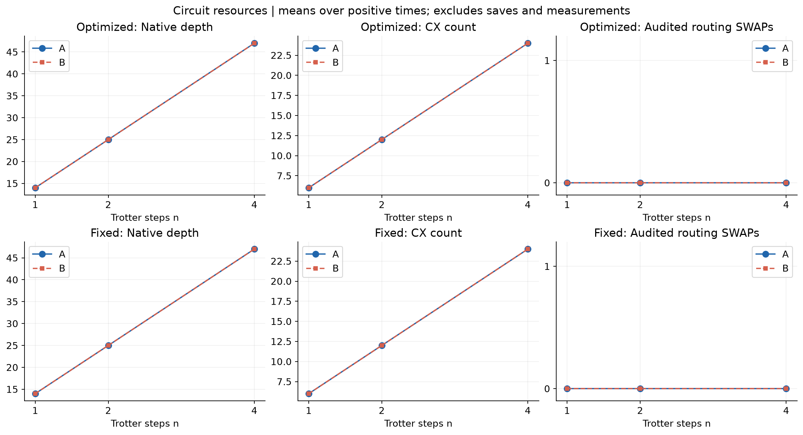
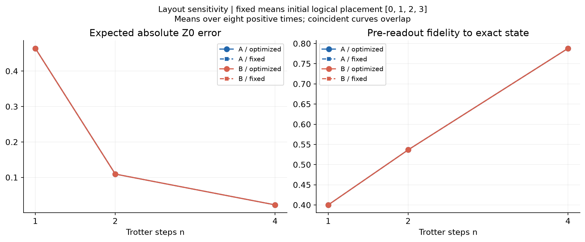

# PS-S3 - Architectural analysis

## Question and evidence

How does first-order Trotter approximation interact with synthetic device noise on a five-qubit line (A) and nine-qubit V2 heavy-hex-inspired reference graph (B)? The executed baseline contains 108 cases and 216 paired ideal/noisy sampled runs. Primary results use SABRE placement; fixed placement is a sensitivity control. All observations below derive from `results/tables/benchmark_results.csv` and its positive-time summary, with raw counts, routing audits and density matrices retained.

## Model and derivation

Four logical spins, open boundary, J=g=1 and hbar=1:

$$H=-J(Z_0Z_1+Z_1Z_2+Z_2Z_3)-g(X_0+X_1+X_2+X_3).$$

The primary state is |0000>; correctness tests also use |0101> (X on q0 and q2) and a deliberately asymmetric state. Pauli strings are q3q2q1q0: Z0 is IIIZ. The exact state is SciPy `expm(-1j*t*H) @ psi0`, with H constructed independently from NumPy tensor products. Its equality to the Qiskit SparsePauliOp matrix is tested.

Because RX(theta)=exp(-i theta X/2) and RZZ(theta)=exp(-i theta ZZ/2), the negative Hamiltonian coefficients require angles -2g*t/n and -2J*t/n. Applying ZZ then X gives `[exp(-i H_X*t/n) exp(-i H_ZZ*t/n)]**n` in matrix order. The independent full-unitary product test detects both sign and ordering errors. At t=0 no evolution gates are inserted.

## Architecture selection before results

A uses the V2 guide's linear-chain reference: nodes 0..4 and links (0,1),(1,2),(2,3),(3,4). B uses the exact page-2 reference: nodes 0..8 and links (0,1),(1,2),(1,6),(2,3),(2,6),(2,5),(3,4),(4,5),(5,6),(6,7),(6,8),(8,0). Every link is explicitly listed in both CX directions in JSON; bidirectionality is a shared implementation convention.

The guide permits custom coupling maps. This study selects its reference architectures: A has four links and maximum degree two; B has twelve links and maximum degree five. The name heavy-hex-inspired follows the guide and does not identify a standard heavy-hex lattice or calibrated IBM device. Both graphs contain the physical path 0-1-2-3, so this four-spin workload can avoid routing even under fixed placement.

## Controls, compilation and audit

The two processors share basis rz/sx/x/cx, level 1, transpiler seed 42, simulator seed 42, and 4096 shots. A depolarizing channel with Aer parameter lambda=.001 follows **every rz, sx and x**; lambda=.005 follows CX. The channel is `(1-lambda)*rho + lambda*I/2**k`. Symmetric readout bit flips have p=.01. No idle, T1/T2, crosstalk or calibration model is used. Noisy RZ is an explicit common synthetic convention.

The preset level-1 pipeline uses SABRE layout and routing. Trial counts are fixed at 20 (layout and swap), with three layout iterations and routing decay heuristic, to avoid CPU-count-dependent trial defaults. Optimized means heuristic-selected placement, not certified global optimality. Fixed means initial logical-to-physical [0,1,2,3]. On both reference graphs, that set already forms the logical chain. Placement remains label dependent in general.

`RoutingCheckpoint`, a read-only analysis pass, records the full physical operation stream after routing and before translation. Counts refer to SWAP instructions at this checkpoint, including routing applied by SabreLayout. Source circuits have no SWAPs. The pass trace and checkpoint operations are preserved per case; replay tests compare checkpoint and final native states. Final native SWAP counts are separately reported and are not routing counts. CX/3 is never used to infer SWAPs. These audited SWAPs count inserted operations before later simplification, not a guarantee of exactly three surviving CX per SWAP.

Each ideal/noisy pair starts with the same native circuit; QPY files and hashes are retained. Diagnostic saves and measurements are appended afterward and excluded from depth and gate counts. `final_index_layout` determines measurement targets and the saved physical subset. The subset is saved in ascending physical order, ancillas traced out, and density indices explicitly permuted into logical order. Every baseline case checks compilation fidelity; the minimum observed value is **1.000000000000**.

## Error and fidelity definitions

Let ze be exact Z0, zi ideal Trotter Z0, zg pre-readout gate-noisy Z0, zr=.98*zg the expected readout value, and zs the sampled value. Exports include absolute and signed differences for zi-ze, zg-zi, zr-zg and zs-zr. Total expected error is |zr-ze| and total sampled error is |zs-ze|. Signed terms telescope; absolute components need not add.

For example, case `A_fixed_n1_t1.50` has absolute component sum 0.932034, while total expected error is 0.863493: cancellation matters. This is not error mitigation.

For N=4096, the plug-in standard error is sqrt((1-zs^2)/N). A Wilson 95% interval is also exported and plotted because the plug-in SE vanishes at an all-identical sample. The ideal sample has its own uncertainty columns. Intervals describe shot uncertainty, not systematic uncertainty or independent-run confidence in architecture rankings. Resetting seed 42 per case may correlate sampling differences; no significance claim is made from small sampled gaps.

Algorithm fidelity is |<exact|Trotter>|^2. Noise-only fidelity is <Trotter|rho_gate|Trotter>. Fidelity to exact is <exact|rho_gate|exact>. All three are pre-readout simulator state diagnostics, not measured hardware fidelities or products of per-gate success probabilities.

## Verified results

Arithmetic means below use the eight positive times 0.25,0.5,...,2.0, separately by processor and n. t=0 remains in raw exports but is excluded from aggregates.

| processor | steps | depth | cx_count | routing_swaps | total_expected_error | algorithm_fidelity | noisy_fidelity_to_trotter | noisy_fidelity_to_exact |
| --- | --- | --- | --- | --- | --- | --- | --- | --- |
| A | 1 | 14.000000 | 6.000000 | 0.000000 | 0.464080 | 0.412778 | 0.966610 | 0.400257 |
| A | 2 | 25.000000 | 12.000000 | 0.000000 | 0.109397 | 0.572892 | 0.930677 | 0.536621 |
| A | 4 | 47.000000 | 24.000000 | 0.000000 | 0.022500 | 0.908469 | 0.865980 | 0.787998 |
| B | 1 | 14.000000 | 6.000000 | 0.000000 | 0.464080 | 0.412778 | 0.966610 | 0.400257 |
| B | 2 | 25.000000 | 12.000000 | 0.000000 | 0.109397 | 0.572892 | 0.930677 | 0.536621 |
| B | 4 | 47.000000 | 24.000000 | 0.000000 | 0.022500 | 0.908469 | 0.865980 | 0.787998 |

Optimized A/B expected errors and fidelities agree to floating-point precision, with identical depths, CX counts, and zero routing SWAPs. Small sampled differences do not establish an architecture ranking.

Best n **only among tested values**, minimizing mean expected absolute Z0 error over positive times:

| processor | layout_mode | steps | total_expected_error |
| --- | --- | --- | --- |
| A | fixed | 4 | 0.022500 |
| A | optimized | 4 | 0.022500 |
| B | fixed | 4 | 0.022500 |
| B | optimized | 4 | 0.022500 |

The trade-off is visible without forcing a crossover: from n=1 to n=4, mean noise-only fidelity drops from 0.966610 to 0.865980, but algorithm fidelity rises from 0.412778 to 0.908469. The approximation improvement wins over the added gate noise within the tested range: mean expected error decreases 0.464080 -> 0.109397 -> 0.022500. No aggregate noise crossover appears among n=1,2,4. This does not imply pointwise monotonic improvement at every time or beyond n=4.

Fixed placement also requires zero SWAPs on both references. At n=4, both use 24 CX gates and depth 47, with mean expected Z0 error 0.022500 and mean fidelity to exact 0.787998. The previous grid-specific routing penalty does not apply to these reference graphs.

The larger processor is not guaranteed to improve this workload. The logical path fits both graphs directly, leaving B's spare qubits and alternate links unnecessary. A tied result under uniform noise is consistent with equivalent compiled gate resources; it does not imply equivalent performance on arbitrary circuits or calibrated hardware.

Full fixed-placement means:

| processor | steps | depth | cx_count | routing_swaps | total_expected_error | noisy_fidelity_to_exact |
| --- | --- | --- | --- | --- | --- | --- |
| A | 1 | 14.000000 | 6.000000 | 0.000000 | 0.464080 | 0.400257 |
| A | 2 | 25.000000 | 12.000000 | 0.000000 | 0.109397 | 0.536621 |
| A | 4 | 47.000000 | 24.000000 | 0.000000 | 0.022500 | 0.787998 |
| B | 1 | 14.000000 | 6.000000 | 0.000000 | 0.464080 | 0.400257 |
| B | 2 | 25.000000 | 12.000000 | 0.000000 | 0.109397 | 0.536621 |
| B | 4 | 47.000000 | 24.000000 | 0.000000 | 0.022500 | 0.787998 |

## Validation and reproducibility

The supporting regression suite passed all **28 tests**. Results are recorded in `data/raw/processor_validation.json`. The corrected reference graphs were evaluated through a fresh execution of all six notebook code cells. All 108 configurations check native gate legality, final logical mapping, compiled ideal-state fidelity, density-matrix validity, and shot totals. The supporting regression suite additionally checks exact V2 edge sets, both CX directions, noise parity, physics conventions, audit replay, forced routing with an asymmetric state, and exported circuit hashes.

Executed environment: Python 3.12.14, Qiskit 2.5.2, Aer 0.17.2. Dependencies are pinned in requirements.txt. Seeds and trial counts reduce stochastic variability; cross-version or cross-platform bitwise identity is not promised.

## Limitations and next steps

Only two reference graphs, one compiler seed, three step counts, one time window, J=g=1, and the primary state 0000 are benchmarked. The 0101 state is a correctness control. Qubit count, degree, and edge count change together, preventing isolation of qubit-budget effects. The noise model omits thermal relaxation, idle noise, crosstalk, and calibration costs of extra links. No universal optimal Trotter count or hardware-performance advantage follows from this experiment.

## Sources and attribution

Official requirements: user-supplied V2_QFF_Phase_1_Master_Guide.pdf, especially the processor table on page 2 and PS-S3 on page 5. The selected edge lists and source-document SHA-256 are recorded in data/raw/processor_reference.json. Research URLs were consulted on 2026-10-13; API behavior was additionally tested against installed versions. The processor topologies follow the selected V2 references; the noise-direction conventions and mathematical implementation are specified above.

- [IBM coupling maps](https://quantum.cloud.ibm.com/docs/en/guides/represent-quantum-computers): Directed coupling constraints; logical versus physical qubits.
- [IBM CouplingMap API](https://quantum.cloud.ibm.com/docs/en/api/qiskit/2.3/qiskit.transpiler.CouplingMap): Line/grid alternatives; heavy-hex construction is a different family. Versioned 2.3 search result consulted; implementation inspected/tested on installed version.
- [IBM heavy-hex lattice](https://www.ibm.com/quantum/blog/heavy-hex-lattice): Physical connectivity trades off with device engineering; dense connectivity is not automatically better hardware.
- [Li, Ding, Xie: SABRE](https://arxiv.org/abs/1809.02573): Primary mapping research motivates heuristic layout and routing; no claim of globally optimal placement.
- [IBM compiler API](https://quantum.cloud.ibm.com/docs/en/api/qiskit/compiler): Native basis, seed, level, direction and callback settings.
- [IBM staged pass manager](https://quantum.cloud.ibm.com/docs/en/api/qiskit/qiskit.transpiler.StagedPassManager): Post-routing hook before translation; analysis checkpoint is read-only.
- [IBM SabreLayout](https://quantum.cloud.ibm.com/docs/en/api/qiskit/qiskit.transpiler.passes.SabreLayout): Explicit trial counts avoid CPU-dependent defaults; this pass can apply routing before the routing stage.
- [IBM SabreSwap](https://quantum.cloud.ibm.com/docs/en/api/qiskit/qiskit.transpiler.passes.SabreSwap): Seeded decay heuristic with 20 routing trials.
- [IBM TranspileLayout](https://quantum.cloud.ibm.com/docs/en/api/qiskit/qiskit.transpiler.TranspileLayout): final_index_layout maps original logical qubits to final output positions.
- [IBM bit ordering](https://quantum.cloud.ibm.com/docs/en/guides/bit-ordering): Little-endian state indices and q3q2q1q0 display.
- [Aer noise models](https://qiskit.github.io/qiskit-aer/tutorials/3_building_noise_models.html): Shared gate noise and symmetric readout assignment channel.
- [Aer depolarizing channel](https://qiskit.github.io/qiskit-aer/stubs/qiskit_aer.noise.depolarizing_error.html): lambda in (1-lambda)rho + lambda I/2^n; not calibrated decoherence.
- [Aer reduced density save](https://qiskit.github.io/qiskit-aer/stubs/qiskit_aer.library.save_density_matrix.html): Save selected qubits before measurement, then explicitly permute into logical order.
- [SciPy expm](https://docs.scipy.org/doc/scipy/reference/generated/scipy.linalg.expm.html): Dense independent matrix exponential reference.

AI assistance: OpenAI Codex assisted implementation, research, testing and documentation. The team must review the code, understand the conclusions, and follow event attribution rules. Actual team names have not been supplied. Source repository: https://github.com/udbhav-metla/Qskit_Online. No event-portal submission has been made.
